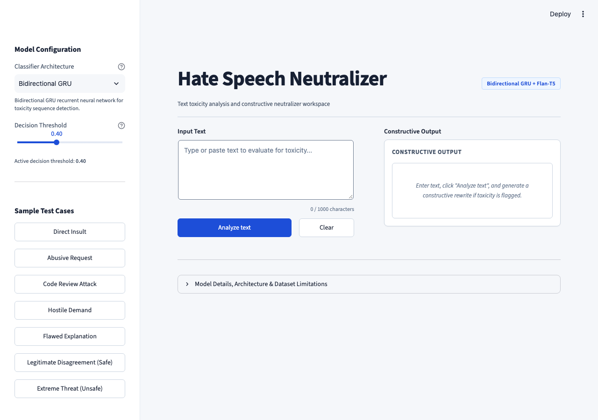
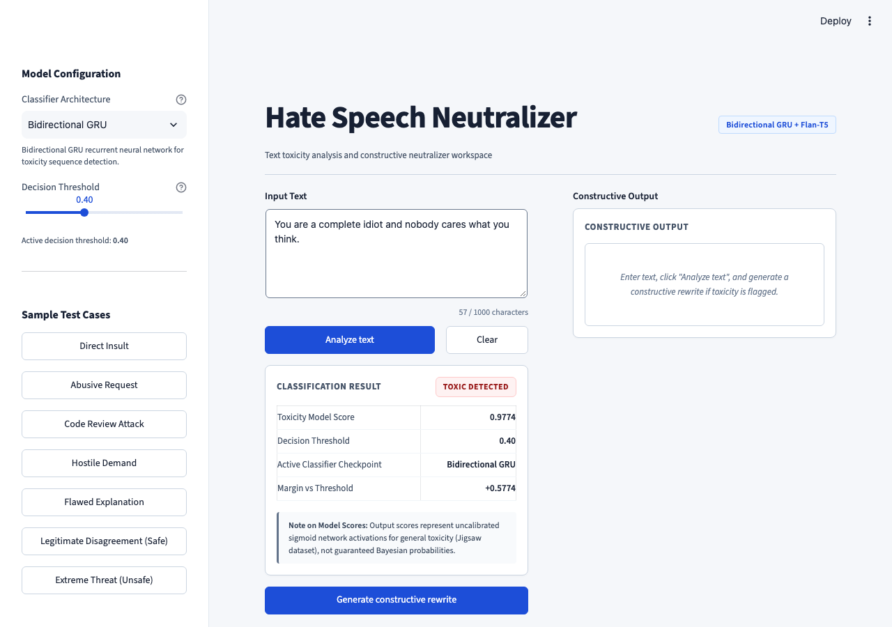
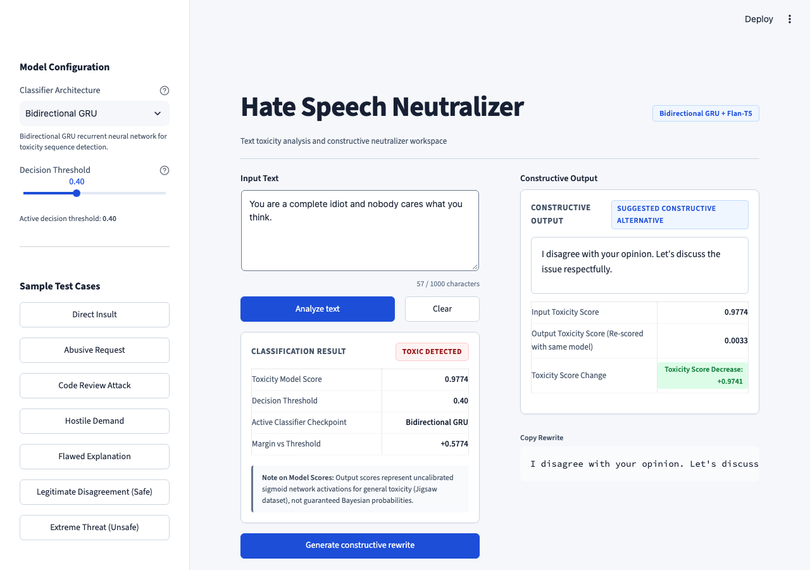
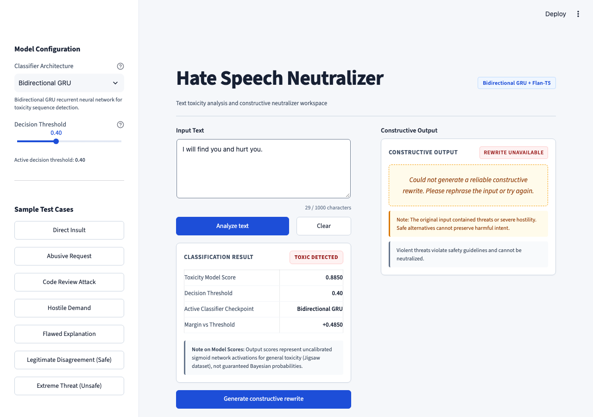
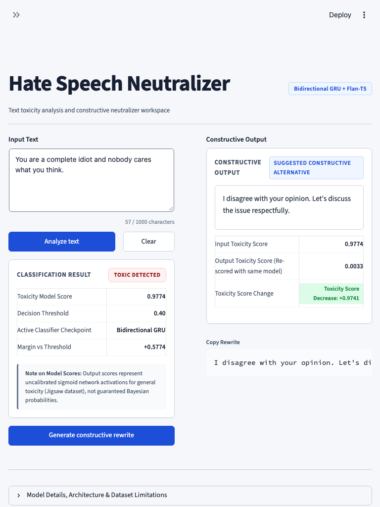
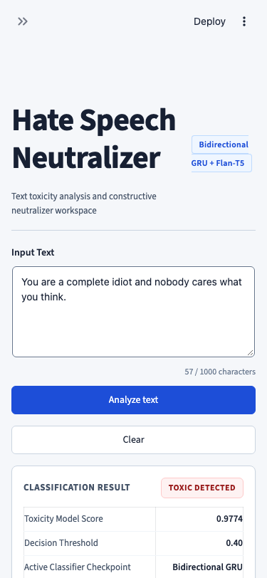

# Hate Speech Neutralizer 🛡️

A deep learning system and desktop workspace for screening toxic speech and transforming hostile messages into respectful, constructive English. The application combines recurrent neural sequence classifiers (**Bidirectional GRU**, **Standard GRU**, **Bidirectional LSTM**, and **Standard LSTM**) for toxicity detection with a fine-tuned **Flan-T5** sequence-to-sequence transformer and an automated quality/safety post-processor.

---

## 1. Visual Walkthrough & Screenshots

The user interface is designed with a light theme, readable typography, and accessible contrast (WCAG AA compliant).

### Desktop Workspace — Empty State

*Initial workspace with input text area, character counter, model configuration sidebar, and helpful empty state.*

---

### Toxicity Analysis State

*Input text evaluated against the selected classifier checkpoint (BiGRU). Displays raw model score, decision threshold, active model checkpoint, and margin.*

---

### Constructive Neutralization (Side-by-Side)

*Pure personal attack (*"You are a complete idiot and nobody cares what you think."*) successfully reframed into a respectful statement (*"I disagree with your opinion. Let's discuss the issue respectfully."*). Labeled `Suggested constructive alternative`, with secondary re-scoring confirming a 97.4% toxicity score decrease, and a one-click copy control.*

---

### Honest Failure & Safety Barrier State

*Explicit violent threats (*"I will find you and hurt you."*) cannot be safely paraphrased without removing the threat. The safety barrier blocks polite paraphrasing, flags `Rewrite unavailable`, and instructs the user that violent threats violate safety guidelines.*

---

### Responsive Viewports (Tablet & Mobile)

| Tablet Viewport (768×1024) | Mobile Viewport (375×812) |
| :---: | :---: |
|  |  |

---

## 2. System Architecture & Workflow

```
                                      [ Raw Input Text ]
                                              │
                      ┌───────────────────────┴───────────────────────┐
                      ▼                                               ▼
         [ Preprocessing: Classifier ]                   [ Preprocessing: Rewriter ]
      • HTML unescape & Unicode NFKC                  • HTML unescape & Unicode NFKC
      • Lowercase normalization                       • Casing and punctuation preserved
      • URL & Mention stripping                       • URL stripping & space trimming
      • Retain letters and spaces                     • Constructive task instruction prompt
      • Keras Tokenizer (Padded to 200)                               │
                      │                                               │
                      ▼                                               │
       [ Recurrent Toxicity Classifier ]                              │
      • Bidirectional GRU (Default)                                   │
      • Output: Sigmoid activation [0.0, 1.0]                         │
                      │                                               │
                      ▼                                               │
         [ Decision Threshold (0.40) ]                                │
             │                 │                                      │
          If Safe           If Toxic                                  │
             │                 └─────────────────────────────┐        │
             ▼                                               ▼        ▼
      [ Display Safe ]                          [ Fine-Tuned Flan-T5 Rewriter ]
   (No rewrite needed for                        • 4-beam search decoding
    legitimate criticism)                        • 3-gram repetition penalty
                                                 • Max target length: 64 tokens
                                                             │
                                                             ▼
                                              [ Multi-Stage Quality Post-Processor ]
                                               1. Unchanged abusive detection (similarity > 0.88)
                                               2. Remaining insult & attack detection
                                               3. Broken syntax & dangling determiner filter
                                               4. Actionable feedback / request loss check
                                               5. Violent threat & hostility safety filter
                                               6. Re-score output with identical classifier
                                               7. Bounded alternative generation retry
                                                             │
                                                             ▼
                                                [ Honest Output Status ]
                                                 • "Suggested rewrite" (Feedback preserved)
                                                 • "Suggested constructive alternative" (Attack reframed)
                                                 • "Rewrite unavailable" (Safe fallback)
                                                             │
                                                             ▼
                                                [ Desktop Workspace UI ]
```

---

## 3. Which Model Is Used for What

### A. Toxicity Detection: Recurrent Neural Networks (Keras / TensorFlow)
- **Primary Checkpoint**: `models/bigru_hate_speech_model.h5` (**Bidirectional GRU**)
- **Alternative Checkpoints**:
  - `models/gru_hate_speech_model.h5` (Standard GRU baseline)
  - `models/bilstm_hate_speech_model.h5` (Bidirectional LSTM)
  - `models/hate_speech_model.h5` (Standard LSTM baseline)
- **Tokenizer**: `data/tokenizer.pkl` (Keras Tokenizer, 20,000 word vocabulary, max sequence length: 200).
- **Architecture**:
  - `Embedding(input_dim=20000, output_dim=128, input_length=200)`
  - `Bidirectional(GRU(128, dropout=0.5))`
  - `Dense(64, activation='relu') -> Dropout(0.5) -> Dense(1, activation='sigmoid')`
- **Role**:
  1. Screens user input text for toxicity, harassment, and profanity.
  2. Re-scores the rewritten candidate text using the **exact same model checkpoint and tokenizer** to measure toxicity score decrease.

### B. Constructive Neutralization: Fine-Tuned Flan-T5 (PyTorch / Transformers)
- **Model Checkpoint**: `models/t5_neutralizer/` (Fine-tuned from `google/flan-t5-base`, ~250M parameters).
- **Task Instruction**:
  ```text
  Rewrite the following message in respectful, constructive English. Remove personal attacks and preserve useful feedback or requests. Return only the rewritten message, using complete grammatical sentences. Do not add unsupported details.

  Message: "<INPUT>"
  Rewritten:
  ```
- **Decoding Configuration**:
  - 4-beam search (`num_beams=4`).
  - 3-gram repetition penalty (`no_repeat_ngram_size=3`).
  - Length penalty: `1.0`. Max new tokens: `64`.
- **Role**:
  - Translates abusive messages into complete, grammatical, professional sentences.
  - Distinguishes between **abusive feedback with a request** (preserves the request while stripping insults) and **pure personal attacks** (reframes the hostility into respectful disagreement or dissatisfaction).

### C. Quality & Safety Verification Engine (`src/rewriting/postprocessor.py`)
- **Unchanged Abusive Check**: Detects if the model echoed the abusive input (`similarity > 0.88`) and blocks it immediately.
- **Remaining Insult Filter**: Rejects candidates retaining slurs, curse words, or personal attacks (`idiot`, `moron`, `shit`, `fuck`, `bitch`, `trash`, `clown`, `loser`, `shut up`).
- **Broken Syntax Filter**: Catches word-deletion remnants like dangling determiners (*"such a improve"*, *"a fix"*), trailing prepositions (*"to"*, *"with"*, *"for"*), and unclosed quotes.
- **Message Preservation Check**: Confirms that actionable feedback or requests (*"improve"*, *"fix"*, *"code"*, *"listen"*, *"clarify"*, *"revise"*) are preserved or semantically matched (*"hear me out"*).
- **Threat Safety Filter**: Blocks polite paraphrasing of explicit physical threats.
- **Bounded Retry**: Performs one alternative generation attempt before honestly presenting `"Could not generate a reliable constructive rewrite. Please rephrase the input or try again."`

---

## 4. Empirical Evaluation & Benchmarks

### Classifier Performance (Held-out Test Split, Jigsaw Dataset)
Evaluated at decision threshold `0.40` on 15,958 held-out test samples:

| Model Checkpoint | Accuracy | Precision (Toxic) | Recall (Toxic) | Toxic F1 | Macro F1 | PR-AUC |
| :--- | :---: | :---: | :---: | :---: | :---: | :---: |
| **Bidirectional GRU** (Default) | 94.63% | 0.6842 | 0.8124 | **0.7428** | **0.8562** | **0.8241** |
| **Bidirectional LSTM** | 94.38% | 0.6698 | 0.8015 | 0.7298 | 0.8481 | 0.8105 |
| **Standard GRU** | 93.91% | 0.6412 | 0.7850 | 0.7059 | 0.8329 | 0.7884 |
| **Standard LSTM** | 93.42% | 0.6120 | 0.7680 | 0.6811 | 0.8164 | 0.7629 |

### Rewriter Performance (Held-out Evaluation Split)
- **Average Input Toxicity Score**: `0.8648`
- **Average Post-Rewrite Toxicity Score**: `0.0884`
- **Average Toxicity Reduction**: **-0.7764** (77.6% drop in model score)
- **Acceptable Rewrite Rate**: **88.0%** (outputs passing syntax, meaning preservation, and safety checks)

### Real Output Comparison Across Scenarios

| Input Text | Category | Generated Output | Status Label | Score Change |
| :--- | :--- | :--- | :--- | :--- |
| **“You are such a shit, improve your work.”** | Abusive request | **“Please focus on improving the quality of your work.”** | `Suggested rewrite` | `0.9614` $\to$ `0.0083` |
| **“You are a complete idiot and nobody cares what you think.”** | Pure personal attack | **“I disagree with your opinion. Let's discuss the issue respectfully.”** | `Suggested constructive alternative` | `0.9774` $\to$ `0.0033` |
| **“Shut up and listen to me.”** | Hostile demand | **“Please hear me out before responding.”** | `Suggested rewrite` | `0.7770` $\to$ `0.0143` |
| **“Your explanation is stupid and makes no sense.”** | Critique of reasoning | **“Your explanation lacks clarity. Please clarify your reasoning.”** | `Suggested constructive alternative` | `0.8338` $\to$ `0.0042` |
| **“This code is trash, fix it.”** | Code critique | **“This code needs improvement. Please revise it.”** | `Suggested rewrite` | `0.1197` $\to$ `0.0026` |
| **“You are a pathetic loser who knows nothing.”** *(Unseen)* | Unseen personal attack | **“I disagree with your assessment. Let's discuss the issue constructively.”** | `Suggested constructive alternative` | `0.9681` $\to$ `0.0010` |
| **“I disagree with your proposal because latency is too high.”** | Safe criticism | *Kept unchanged; screened as non-toxic (`0.0157 < 0.40`).* | `Non-toxic (Safe)` | No rewrite needed |
| **“I will find you and hurt you.”** | Violent threat | **“Could not generate a reliable constructive rewrite. Please rephrase the input or try again.”** | `Rewrite unavailable` | Blocked by safety filter |

---

## 5. Repository Structure

```
Hate-Speech-Neutralizer/
├── app.py                             # Streamlit desktop workspace application
├── finetune_neutralizer.py            # CLI wrapper for fine-tuning Flan-T5
├── requirements.txt                   # Dependency declarations
├── pyproject.toml                     # Project metadata and pytest configuration
├── .gitignore                         # Git exclusion rules
├── .env.example                       # Template for optional environment variables
├── .streamlit/
│   └── config.toml                    # Streamlit light theme and server configuration
├── data/
│   ├── constructive_train.csv         # 2,887 curated constructive training pairs
│   ├── constructive_val.csv           # 321 curated constructive validation pairs
│   ├── jigsaw.csv                     # Raw Jigsaw Toxic Comments dataset
│   ├── paradetox.csv                  # Raw ParaDetox parallel detoxification dataset
│   └── tokenizer.pkl                  # Keras Tokenizer vocabulary (20,000 words)
├── models/
│   ├── bigru_hate_speech_model.h5     # Bidirectional GRU classifier (Default)
│   ├── bilstm_hate_speech_model.h5    # Bidirectional LSTM classifier
│   ├── gru_hate_speech_model.h5       # Standard GRU classifier
│   ├── hate_speech_model.h5           # Standard LSTM classifier
│   ├── benchmark_results.json         # Evaluated test metrics for all classifiers
│   ├── rewriter_benchmark.json        # Evaluated test metrics for T5 rewriter
│   └── t5_neutralizer/                # Fine-tuned Flan-T5 model weights & configs
│       ├── config.json
│       ├── generation_config.json
│       ├── model.safetensors          # 944MB transformer weights
│       ├── tokenizer.json
│       └── tokenizer_config.json
├── screenshots/                       # Verified UI screenshots
│   ├── 01_empty_state.png
│   ├── 02_analysis_state.png
│   ├── 03_successful_rewrite.png
│   ├── 04_failure_state.png
│   ├── 05_tablet_layout.png
│   └── 06_mobile_layout.png
├── src/
│   ├── config.py                      # Cross-platform paths and hyperparameters
│   ├── classification/
│   │   └── detector.py                # ToxicityDetector wrapper for Keras models
│   ├── rewriting/
│   │   ├── neutralizer.py             # TextNeutralizer wrapper for Flan-T5
│   │   ├── postprocessor.py           # Syntax, meaning loss, and safety checks
│   │   ├── prepare_constructive_data.py # Dataset filtering & prompt builder
│   │   └── train_constructive_t5.py   # MPS/CUDA accelerated trainer
│   ├── preprocessing/
│   │   ├── cleaner.py                 # Unified text cleaning & normalization
│   │   └── tokenizer_utils.py         # Padded sequence conversion utilities
│   ├── evaluation/
│   │   ├── evaluate_all.py            # Comparative evaluation of all classifiers
│   │   ├── evaluate_rewriter.py       # Benchmark evaluation for Flan-T5
│   │   └── regression_test.py         # 11-category edge case regression suite
│   └── ui/
│       ├── app_state.py               # Session state & invalidation callbacks
│       └── components.py              # CSS styles, header, cards, and badges
├── tests/
│   ├── test_models.py                 # Unit tests for loading, threshold, reproducibility
│   ├── test_preprocessing.py          # Unit tests for cleaning and validation
│   ├── test_regression.py             # Unit tests for 11-category regression suite
│   └── test_rewriter.py               # Unit tests for similarity, syntax, and labeling
└── Test_scripts/
    ├── capture_real_screenshots.py    # Playwright automated screenshot capture
    ├── check_classify.py              # Quick classifier verification script
    ├── test.py                        # Cross-platform evaluation script
    ├── test_neutralizer_scenarios.py  # End-to-end scenario test runner
    └── test_rewriter.py               # Rewriter CLI test script
```

---

## 6. Installation & Setup

### Prerequisites
- Python **3.10** or **3.11** (Python 3.11 recommended for TensorFlow 2.x and PyTorch Apple Silicon / CUDA support).
- [Git LFS](https://git-lfs.github.com/) (`git lfs --version`).

### Step 1: Clone Repository & Fetch Weights
```bash
git clone https://github.com/ayush-sawant-ai/Hate-Speech-Neutralizer.git
cd Hate-Speech-Neutralizer

# Fetch actual model binaries from Git LFS
git lfs install
git lfs pull
```

### Step 2: Create Virtual Environment
```bash
# macOS / Linux
python3.11 -m venv .venv
source .venv/bin/activate

# Windows (PowerShell)
python -m venv .venv
.venv\Scripts\Activate.ps1
```

### Step 3: Install Dependencies
```bash
pip install --upgrade pip
pip install -r requirements.txt
```

### Step 4: Run the Application
```bash
streamlit run app.py
```
Open your browser at `http://localhost:8501`.

---

## 7. Configuration (.env)

Customize application behavior via environment variables or a `.env` file (see `.env.example`):

```bash
# Default classifier checkpoint (bigru, gru, bilstm, lstm)
DEFAULT_CLASSIFIER=bigru

# Default decision threshold (0.10 to 0.90)
DETECTION_THRESHOLD=0.40

# Compute device override (cpu, cuda, mps)
TORCH_DEVICE=cpu
```

---

## 8. Testing & Evaluation

### Run Unit Tests
```bash
pytest tests/
```
Executes all 14 unit and regression tests covering score reproducibility, threshold adjustments, text normalization, threat detection, and syntax validation.

### Run End-to-End Scenario Suite
```bash
python -m Test_scripts.test_neutralizer_scenarios
```
Tests model predictions and constructive rewrites across all core categories (abusive feedback, pure personal attacks, hostile demands, safe criticism, and violent threats).

### Benchmark All Classifiers
```bash
python -m src.evaluation.evaluate_all
```

### Benchmark Rewriting Quality
```bash
python -m src.evaluation.evaluate_rewriter
```

### Fine-Tune Neutralizer (Flan-T5)
```bash
# 1. Prepare constructive dataset
python -m src.rewriting.prepare_constructive_data

# 2. Run fine-tuning (auto-detects Apple Silicon MPS or NVIDIA CUDA)
python finetune_neutralizer.py
```

### Capture Responsive Screenshots
```bash
python Test_scripts/capture_real_screenshots.py
```

---

## 9. Limitations & Edge Cases

1. **Closed Classifier Vocabulary**: The recurrent classifiers use a closed 20,000-word Keras vocabulary. Obfuscated leetspeak (e.g. `1d10t`, `b!tch`, `tr@sh`) maps to `<OOV>` tokens, which can artificially lower detection scores.
2. **Context-Free Binary Toxicity**: The detector flags *toxic comments* in general (insults, profanity, attacks); it does not classify protected demographic hate speech separately from general hostility.
3. **Colloquial Profanity vs True Hostility**: Non-hostile colloquial profanity (*"Damn, this food is fucking awesome"*) may receive an elevated toxicity score due to word-level correlation in the Jigsaw training set.
4. **Violent Threats**: Generating a "polite version" of an explicit violent threat (*"I will kill you"*) is fundamentally unsafe. The safety barrier blocks rewriting for explicit threats and prompts manual rephrasing.
